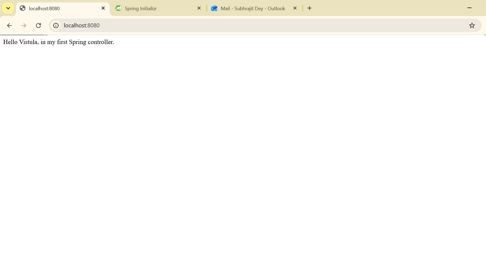
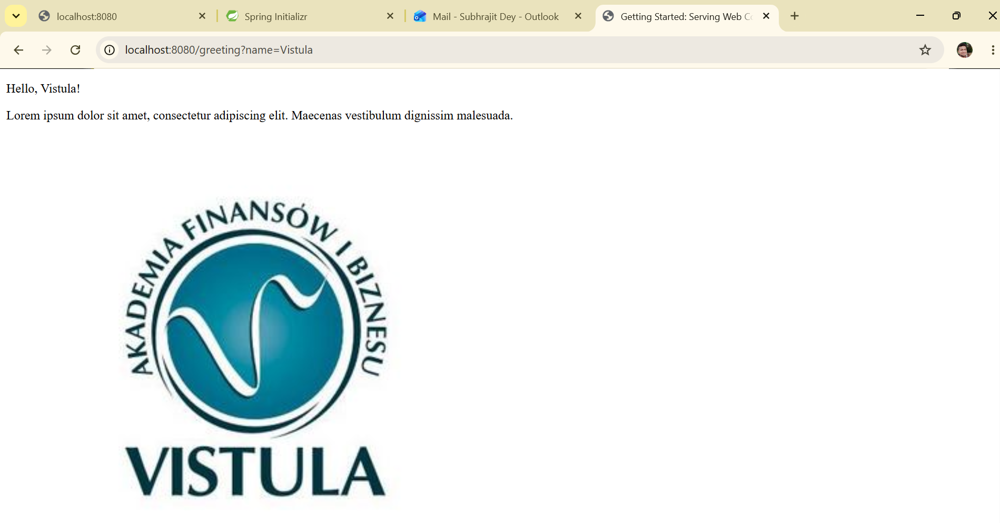

# First Spring Framework App

A simple Spring Boot web application created for **Exercise 16 – Task 1** (Vistula University).

**Author:** Subhrajit Dey (77751)

## Technologies
- Java
- Spring Boot (Spring Web)
- Thymeleaf
- Maven
- IntelliJ IDEA

## Project structure
- `controller/HelloController.java` – handles HTTP requests
- `resources/templates/greeting.html` – Thymeleaf view
- `resources/static/images/vistula.png` – image shown on the greeting page

## How to run
1. Open the project in IntelliJ IDEA.
2. Run `FirstProjectJavaSpringApplication`.
3. The app starts on `http://localhost:8080`.

## Use cases

### Use case 1 – Plain text response from a controller
**Request:** `GET http://localhost:8080/`

The `hello()` method uses `@GetMapping("/")` together with `@ResponseBody`, so the returned String is sent directly to the browser as text instead of being treated as a view name.

### Use case 2 – Returning a view (MVC) with a parameter
**Request:** `GET http://localhost:8080/greeting?name=Vistula`

The `greeting()` method reads the `name` request parameter (default value: `World`), adds it to the `Model`, and returns the `greeting` view. Thymeleaf renders `greeting.html`, showing a personalised greeting, some text and the Vistula logo.

## @Controller vs @RestController
- `@RestController` = `@Controller` + `@ResponseBody` on every method – the return value is the response body.
- `@Controller` – the returned String is the **name of a view** (template), unless the method is marked with `@ResponseBody`.